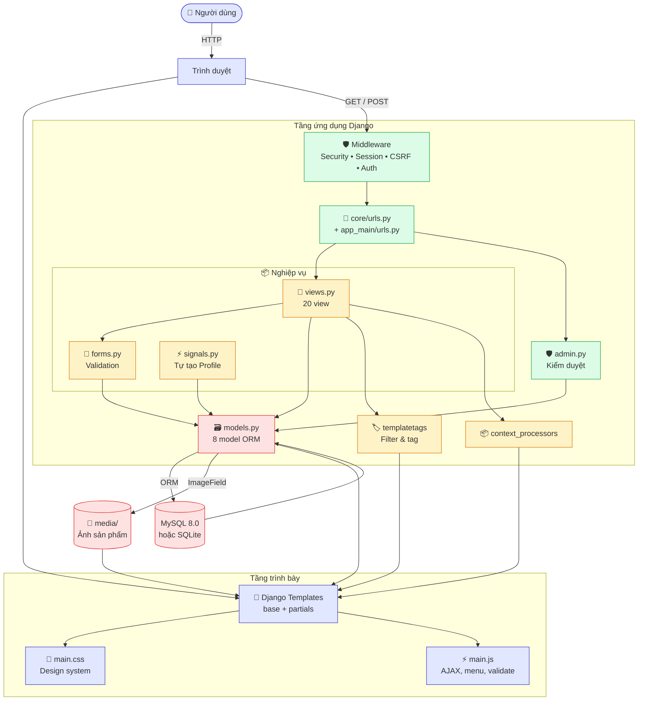
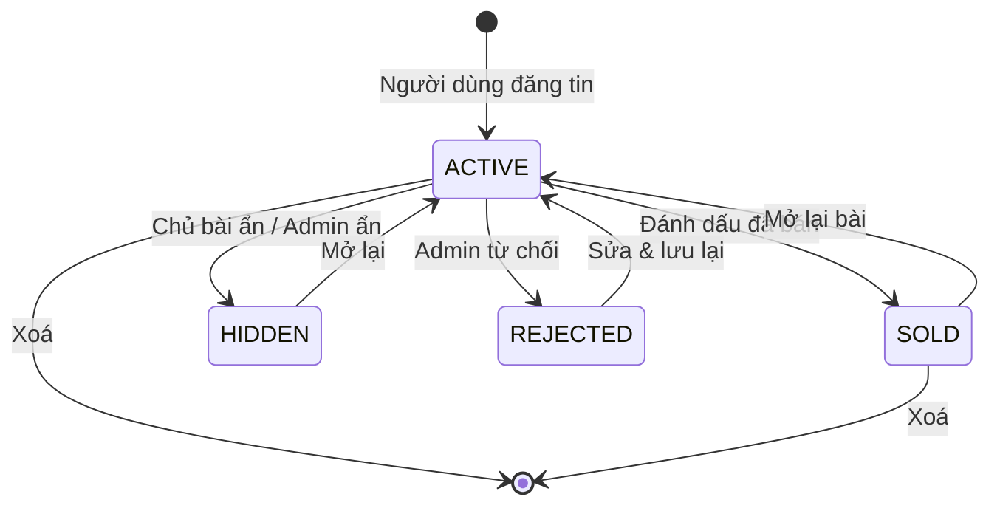

# 📚 SáchGóc Uni — Sàn Giao Dịch & Chia Sẻ Đồ Dùng Sinh Viên

[](https://www.djangoproject.com/)
[](https://www.python.org/)
[](https://www.mysql.com/)
[](https://tailwindcss.com/)

> **Đồ án Công nghệ Phần mềm** — Nền tảng thương mại điện tử dành cho sinh viên
> Trường Đại học Kiến trúc Đà Nẵng và cộng đồng sinh viên nói chung.

Chuyên dụng cho **mua bán sách cũ, giáo trình, dụng cụ học tập** và **tặng đồ dùng 0đ**.

---

## 📑 Mục lục

1. [Tính năng](#-tính-năng)
2. [Công nghệ sử dụng](#-công-nghệ-sử-dụng)
3. [Cài đặt & chạy dự án](#-cài-đặt--chạy-dự-án)
4. [Tài khoản mẫu](#-tài-khoản-mẫu)
5. [Cấu trúc dự án](#-cấu-trúc-dự-án)
6. [Kiểm thử](#-kiểm-thử)
7. [Sơ đồ kiến trúc](#-sơ-đồ-kiến-trúc)

---

## ✨ Tính năng

### 🛒 Nghiệp vụ chính

| Tính năng | Mô tả |
|---|---|
| 📖 **Mua bán sản phẩm** | Đăng bán giáo trình, dụng cụ vẽ, thiết bị với giá tuỳ chọn |
| 🎁 **Tặng miễn phí 0đ** | Chuyên mục tặng lại đồ cho tân sinh viên |
| 🔍 **Tìm kiếm thông minh** | Tìm theo tiêu đề, mô tả, mã học phần, khoa |
| 🧩 **Bộ lọc nâng cao** | Lọc theo danh mục, tình trạng, khoa, khoảng giá |
| ↕️ **5 kiểu sắp xếp** | Mới nhất, cũ nhất, giá tăng/giảm, phổ biến nhất |
| 📄 **Phân trang** | Tự động chia trang, giữ nguyên bộ lọc khi chuyển trang |

### 👥 Tương tác & niềm tin

| Tính năng | Mô tả |
|---|---|
| 💬 **Bình luận & trả lời** | Hỏi đáp trực tiếp, hỗ trợ trả lời lồng 1 cấp |
| ♡ **Wishlist** | Lưu sản phẩm yêu thích (AJAX, không tải lại trang) |
| ⭐ **Đánh giá uy tín** | Chấm điểm 1-5 sao cho người bán, mỗi người 1 lần |
| 📊 **Trang hồ sơ** | Lịch sử bán, số tin đang bán, điểm uy tín, đánh giá nhận về |
| 🚩 **Báo cáo vi phạm** | Người dùng tố bài đăng, Admin xử lý |

### 🛡️ Bảo mật & kiểm duyệt

| Tính năng | Mô tả |
|---|---|
| 🔐 **Xác thực** | Đăng ký/đăng nhập bằng username **hoặc** Gmail |
| 🛡️ **Chống CSRF** | Mọi hành động đổi trạng thái đều POST + CSRF token |
| 🔑 **Mật khẩu mạnh** | Tối thiểu 8 ký tự, có hoa + số, không chứa thông tin cá nhân |
| 🚫 **Phân quyền** | Chỉ chủ bài đăng được sửa/xoá; chỉ tác giả/chủ bài xoá bình luận |
| 📋 **Vòng đời bài đăng** | Chờ duyệt → Đang hiển thị → Đã bán / Bị từ chối / Đã ẩn |
| 🛡️ **Trang quản trị** | Duyệt/ẩn/từ chối bài đăng, khoá tài khoản, xử lý báo cáo |
| 🧹 **Kiểm duyệt tự động** | Bài chưa duyệt không hiển thị trên trang chủ |

### 🎨 Trải nghiệm người dùng

- Giao diện responsive (mobile → desktop), hiệu ứng hover mượt mà
- Thông báo toast + hộp thoại thông báo tự động biến mất
- Trạng thái rỗng (empty state) thân thiện cho mọi danh sách
- Trang lỗi 404 / 500 riêng đồng bộ giao diện
- Thư viện ảnh sản phẩm nhiều ảnh (tối đa 5 ảnh/bài)
- Đếm lượt xem bài đăng

---

## 🛠 Công nghệ sử dụng

| Lớp | Công nghệ | Vai trò |
|---|---|---|
| **Frontend** | Django Template + Tailwind CSS (bản **lưu cục bộ**) | Giao diện responsive |
| **Backend** | Django 4.2 / 5.2 (MTV) | Xử lý logic nghiệp vụ |
| **CSDL** | MySQL 8.0 (mặc định) hoặc SQLite | Lưu trữ dữ liệu qua ORM |
| **Cấu hình** | django-environ + `.env` | Quản lý bí mật, không hardcode |
| **Media** | Pillow | Xử lý & kiểm tra ảnh tải lên |

> **Về Tailwind CSS:** thư viện được tải về lưu tại `static/js/tailwind.min.js` (441KB)
> và được nạp bằng thẻ `<script>` **cục bộ**, không dùng CDN.
> Nhờ vậy dự án **vẫn hiển thị đầy đủ giao diện khi không có mạng** — điều mà
> `<script src="https://cdn.tailwindcss.com">` của bản cũ không làm được.
> Bảng màu thương hiệu được khai báo trong `templates/base.html`.
>
> Nếu muốn dùng Tailwind đúng chuẩn production, thay file trên bằng bản build
> từ Tailwind CLI (không cần mạng khi chạy web server).

`static/css/main.css` đặt **sau** Tailwind để ghi đè các component dùng chung
(`.btn`, `.card`, `.badge`, `.form-input`...) và chứa design token của dự án.

---

## 🚀 Cài đặt & chạy dự án

### Bước 1 — Cài thư viện

```bash
pip install -r requirements.txt
```

### Bước 2 — Tạo file cấu hình

```bash
cp .env.example .env      # Windows: copy .env.example .env
```

Mở `.env` và chỉnh thông tin MySQL cho đúng máy của bạn:

```env
USE_SQLITE=False
DB_NAME=sachgocuni_db
DB_USER=root
DB_PASSWORD=123456
DB_HOST=127.0.0.1
DB_PORT=3306
```

<details>
<summary>💡 Không muốn dùng XAMPP/MySQL?</summary>

Đặt `USE_SQLITE=True` trong `.env` — dự án sẽ tự chuyển sang SQLite,
không cần cài đặt hay bật MySQL. Phần còn lại giữ nguyên.

</details>

### Bước 3 — Tạo database

**Nếu dùng MySQL**, tạo database trước:

```sql
CREATE DATABASE sachgocuni_db CHARACTER SET utf8mb4 COLLATE utf8mb4_unicode_ci;
```

### Bước 4 — Áp dụng migration

```bash
python manage.py migrate
```

### Bước 4b — Nạp dữ liệu múi giờ vào MySQL (chỉ khi dùng MySQL)

Bảng `mysql.time_zone_*` trên XAMPP/MySQL mới cài thường **để trống**, khiến
trang quản trị báo lỗi `Database returned an invalid datetime value`. Chạy
script này **một lần duy nhất** (tự dò đúng cấu trúc bảng MySQL 5.6 / 8.x):

```bash
python load_tzinfo.py
```

Script nạp ~598 múi giờ từ thư viện `zoneinfo` của Python, không cần
`mysql_tzinfo_to_sql`. Bỏ qua bước này nếu bạn dùng SQLite.

### Bước 5 — Sinh ảnh minh hoạ cho sản phẩm mẫu

```bash
python generate_images.py
```

Vẽ 34 ảnh đại diện bằng Pillow (nền gradient theo màu danh mục, biểu tượng,
tên sản phẩm, nhãn tình trạng), lưu vào `media/posts/seed/`. Bỏ qua bước này
nếu không cần ảnh mẫu.

### Bước 6 — Nạp dữ liệu mẫu

```bash
python seed_data.py
```

Tạo 6 danh mục, 34 sản phẩm (có gán ảnh), hơn 90 bình luận, yêu thích và
đánh giá. Thời gian đăng được rải rác trong 30 ngày gần nhất cho tự nhiên.

### Bước 7 — Khởi chạy

```bash
python manage.py runserver
```

Truy cập: **http://127.0.0.1:8000/**

<details>
<summary>🛡️ Trang quản trị — chi tiết</summary>

**Địa chỉ:** http://127.0.0.1:8000/django-admin/
**Tài khoản:** `admin` / `admin123`

Chức năng có sẵn:

| Trang | Chức năng |
|---|---|
| **Tổng quan** | Thống kê nhanh số bài đăng, người dùng, bình luận |
| **Bài đăng** | Duyệt / ẩn / từ chối, đánh dấu đã bán, làm nổi bật (đưa lên đầu) |
| **Báo cáo vi phạm** | Xử lý hoặc bỏ qua báo cáo của người dùng |
| **Bình luận** | Xem và xoá bình luận vi phạm |
| **Danh mục** | Thêm/sửa danh mục, đặt thứ tự hiển thị |
| **Hồ sơ sinh viên** | Mã SV, khoa ngành, điểm uy tín |
| **Yêu thích** | Thống kê sản phẩm được yêu thích |
| **Đánh giá** | Xem điểm uy tín và nhận xét |
| **Người dùng** | Khoá / mở khoá tài khoản, phân quyền staff |

Tất cả thao tác kiểm duyệt đều hỗ trợ **chọn nhiều dòng rồi áp dụng hàng loạt**.

</details>

---

## 🔑 Tài khoản mẫu

| Vai trò | Username | Mật khẩu | Đường dẫn |
|---|---|---|---|
| 👑 Quản trị | `admin` | `admin123` | `/django-admin/` |
| 🎓 Sinh viên | `sinhvien_demo` | `123456` | `/dang-nhap/` |
| 🎓 Sinh viên | `thanhhoa` | `123456` | `/dang-nhap/` |
| 🎓 Sinh viên | `minhthu` | `123456` | `/dang-nhap/` |
| 🎓 Sinh viên | `quynhanh` | `123456` | `/dang-nhap/` |

> Trang đăng nhập có nút **"Điền nhanh"** để test tiện hơn.

---

## 📁 Cấu trúc dự án

```text
24CT1-NGUYEN_VAN HAO/
│
├── core/                          # Cấu hình dự án cấp cao nhất
│   ├── settings.py                # Đọc cấu hình từ .env, MySQL/SQLite
│   ├── urls.py                    # Định tuyến gốc + xử lý 404/500
│   ├── wsgi.py / asgi.py          # Cổng giao tiếp web server
│
├── app_main/                      # Ứng dụng chính
│   ├── models.py                  # 8 model: Category, Profile, Post, PostImage,
│   │                              #   Favorite, Comment, Review, Report
│   ├── views.py                   # 20 view xử lý toàn bộ nghiệp vụ
│   ├── forms.py                   # Form + validation tập trung
│   ├── urls.py                    # 20 route
│   ├── admin.py                   # Trang quản trị kiểm duyệt
│   ├── signals.py                 # Tự tạo Profile khi đăng ký
│   ├── context_processors.py      # Biến dùng chung cho template
│   ├── templatetags/app_extras.py # Filter & tag tùy chỉnh
│   ├── tests.py                   # 85 test tự động
│   └── migrations/                # Lịch sử cấu trúc CSDL
│
├── templates/                     # Template dùng chung
│   ├── base.html                  # Khung trang (nav, messages, footer)
│   ├── 404.html / 500.html        # Trang lỗi
│   ├── app_main/                  # 10 trang nghiệp vụ
│   ├── registration/              # Đăng nhập / Đăng ký
│   └── partials/                  # navbar, footer, messages, card, phân trang
│
├── static/
│   ├── css/main.css               # Design token + component dùng chung
│   ├── js/tailwind.min.js         # Tailwind CSS lưu cục bộ (offline)
│   └── js/main.js                 # Menu, yêu thích AJAX, validate mật khẩu
│
├── media/                         # Ảnh người dùng tải lên (không commit)
│   └── posts/seed/                # Ảnh mẫu do generate_images.py tạo
├── seed_data.py                   # Script nạp dữ liệu mẫu
├── generate_images.py             # Script sinh ảnh minh hoạ (Pillow)
├── load_tzinfo.py                 # Nạp dữ liệu múi giờ vào MySQL (chạy 1 lần)
├── requirements.txt
├── .env.example                   # Mẫu cấu hình (copy thành .env)
└── manage.py
```

---

## 🧪 Kiểm thử

```bash
python manage.py test                    # Chạy toàn bộ
python manage.py test app_main.tests.InteractionTests   # Chỉ 1 nhóm
python manage.py test --verbosity 2      # Chi tiết từng test
```

**85 test tự động** bao phủ:

| Nhóm | Số test | Nội dung |
|---|---|---|
| Model | 16 | Sinh slug, đồng bộ trạng thái, ràng buộc unique |
| Form | 11 | Mật khẩu yếu, Gmail trùng, trùng username |
| Public view | 15 | Tìm kiếm, lọc, sắp xếp, phân trang |
| Auth | 7 | Đăng ký, đăng nhập bằng email, đăng xuất |
| Phân quyền | 8 | Chặn truy cập trái phép, sở hữu bài đăng |
| Tương tác | 14 | Yêu thích, bình luận, đánh giá, báo cáo |
| Hồ sơ | 3 | Sửa hồ sơ, đổi mật khẩu |
| **Tổng** | **85** | ✅ |

Bao gồm các test bảo mật quan trọng:

- ❌ Đổi trạng thái bằng `GET` phải bị từ chối (405) — chống CSRF
- ❌ Sửa/xoá bài đăng của người khác phải bị chặn
- ❌ Mật khẩu rỗng không gây crash (lỗi `IndexError` ở bản cũ)
- ✅ Hành trình đầy đủ: đăng ký → đăng tin → tìm kiếm → yêu thích → bình luận → đánh giá

---

## 📊 Sơ đồ kiến trúc

### Kiến trúc tổng thể (MVC)



### Sơ đồ quan hệ CSDL (ERD)

```mermaid
erDiagram
    User ||--|| Profile : "có hồ sơ"
    User ||--o{ Post : "đăng tin"
    User ||--o{ Comment : "viết bình luận"
    User ||--o{ Review : "được đánh giá"
    User ||--o{ Report : "gửi báo cáo"
    User ||--o{ Favorite : "yêu thích"
    Category ||--o{ Post : "phân loại"
    Post ||--o{ PostImage : "có nhiều ảnh"
    Post ||--o{ Comment : "nhận bình luận"
    Post ||--o{ Favorite : "được yêu thích"
    Post ||--o{ Report : "bị báo cáo"
    Post ||--o{ Review : "được đánh giá"
    Comment ||--o{ Comment : "trả lời"

    User {
        int id PK
        string username UK
        string email UK
        string first_name
        string last_name
        bool is_staff
        bool is_active
    }

    Profile {
        int id PK
        int user_id FK UK
        string student_id
        string faculty
        string phone
        text bio
        image avatar
    }

    Category {
        int id PK
        string name
        string slug UK
        string icon
        int order
    }

    Post {
        int id PK
        string title
        string slug UK
        text description
        int seller_id FK
        int category_id FK
        string course_code
        string faculty
        decimal price
        bool is_free
        string condition
        string location
        image image
        string status
        bool is_sold
        int view_count
        datetime created_at
    }

    PostImage {
        int id PK
        int post_id FK
        image image
        int order
    }

    Favorite {
        int id PK
        int user_id FK
        int post_id FK
        datetime created_at
    }

    Comment {
        int id PK
        int post_id FK
        int author_id FK
        int parent_id FK
        text content
        datetime created_at
    }

    Review {
        int id PK
        int seller_id FK
        int reviewer_id FK
        int post_id FK
        int rating "1-5 sao"
        text content
        datetime created_at
    }

    Report {
        int id PK
        int post_id FK
        int reporter_id FK
        string reason
        text detail
        string status
        datetime created_at
    }
```

### Vòng đời bài đăng



---

## 📝 Ghi chú kỹ thuật

### Vì sao bỏ cấu hình MySQL hardcode?

Bản cũ ghi cứng `PORT = '3307'` và `PASSWORD = ''`, khiến dự án **không kết nối được**
với MySQL thật. Nay mọi thông tin nhạy cảm đọc từ `.env` nên chạy được trên mọi máy.

### Vì sao mọi thay đổi trạng thái dùng POST?

Bản cũ cho phép đánh dấu "đã bán" / "yêu thích" bằng thẻ `<a href>` (GET).
Kẻ tấn công có thể chèn ảnh `` vào trang khác để tự ý
đổi trạng thái — đây là lỗ hổng **CSRF**. Nay dùng `@require_POST` + CSRF token.

### Vì sao có bảng `Favorite` thay vì `ManyToManyField` trực tiếp?

`ManyToManyField` không lưu thời điểm yêu thích. Bảng nối `Favorite` cho phép
hiển thị "yêu thích gần đây" và thêm ràng buộc unique `(user, post)`.

### Vì sao `STATIC_URL` phải có dấu `/` ở đầu?

Nếu đặt `STATIC_URL = 'static/'` (thiếu dấu `/`), thẻ `` sinh ra
đường dẫn tương đối. Ở trang chủ (`/`) nó vô hại, nhưng ở trang có đường dẫn lồng
nhau (`/san-pham/1/`) trình duyệt sẽ yêu cầu `/san-pham/static/css/main.css`
→ **404, mất toàn bộ CSS**. Vì vậy bắt buộc dùng `STATIC_URL = '/static/'`.

### Hiệu năng

- Index được đặt trên `created_at`, `(status, created_at)`, `(category, status)`
- `select_related` cho seller/category, `prefetch_related` cho ảnh & bình luận
- Tăng lượt xem bằng `F()` expression, không tốn query `SELECT`
- Ảnh dùng `loading="lazy"` để tải trang nhanh hơn

---

## 📄 Giấy phép

Dự án phục vụ mục đích học tập. Đồ dùng học tập được giao dịch giữa sinh viên,
người bán tự chịu trách nhiệm về tình trạng sản phẩm và giao dịch.

---

<div align="center">

**SáchGóc Uni** — Đồ án Công nghệ Phần mềm
Trường Đại học Kiến trúc Đà Nẵng

Made with ❤️ cho cộng đồng sinh viên

</div>
