# Kiến trúc SáchGóc Uni — sơ đồ chi tiết

File companion của `sachgocuni-architecture.drawio` (và `.drawio.png`).

- **Nguồn:** `app_main/` + `core/` của repo `24CT1-NGUYENVANHAO/congnghephanmen` (branch `main`, HEAD `6b285f3`).
- **Số node:** 44 node + 9 dải + 9 tiêu đề dải = 62 đỉnh, 30 cạnh.
- **Vẽ bằng:** Mermaid `flowchart TD` (nguồn dưới) → convert bằng draw.io CLI (`draw.io.exe -x -f xml`) → xuất PNG có nhúng XML (mở lại editable).
- **Tô màu** theo 9 lớp: tác nhân (chàm) · giao diện (xanh dương) · định tuyến (vàng) · nghiệp vụ (xanh lá) · form (xanh ngọc) · dữ liệu (hồng) · CSDL (hồng đậm) · phụ trợ (xám) · script (tím).

## Vì sao GitDiagram chỉ ra 19 node?

GitDiagram gộp theo *năng lực* (capability), không theo từng file/hàm:

| GitDiagram gộp | Thực tế trong repo | Lệch |
|---|---|---|
| `views.py` (38 `def`, 34 view) | 1 node "Views" | −33 |
| 9 model trong `models.py` | 1 node "Models" | −8 |
| 24 template + 3 static | 1 node "Templates" | −26 |
| 4 migration + `signals.py` | gộp vào "Models" | −4 |
| 9 form trong `forms.py` | gộp vào "Views" | −9 |
| `admin.py`, `context_processors`, `app_extras` (7 filter/tag) | không hiện | −3 |
| 4 script chạy tay (`seed_data`, `load_tzinfo`, `generate_images`, `check_db`) | không hiện | −4 |
| **Tổng node** | **19** | **↔ 44** |

GitDiagram vẫn đúng về **cấu trúc quan hệ** (đã regenerate sau refactor MySQL-only và MySQL database xuất hiện đúng). Bản này chỉ thêm chi tiết để dùng trong báo cáo giữa kỳ.

## Số liệu kiểm chứng từ code

| Lớp | Số node | Nguồn |
|---|---|---|
| Tác nhân | 2 | Sinh viên (mua/bán/tặng), Quản trị viên (`is_staff`) |
| Giao diện | 10 | `templates/` (24 file) + `static/` (3 file) — gộp theo trang |
| Định tuyến | 3 | `core/urls.py` (2 route) + `app_main/urls.py` (34 route) + `staff_required` |
| Nghiệp vụ | 8 | 34 view gộp thành 8 nhóm (sàn hàng, ảnh, tương tác, đơn hàng, tài khoản, báo cáo vi phạm, quản trị, trang tĩnh) |
| Kiểm tra dữ liệu | 3 | 9 form trong `app_main/forms.py` |
| Dữ liệu | 6 | 9 model (Category, Profile, Post, PostImage, Favorite, Comment, Review, Report, Order) gộp theo quan hệ |
| CSDL | 1 | MySQL/MariaDB `sachgocuni_db`, cổng 3307, utf8mb4, 19 bảng |
| Phụ trợ | 7 | `apps.py`, `signals.py`, `context_processors.py`, `app_extras.py`, `admin.py`, migrations, tests (140) |
| Script vận hành | 4 | `seed_data.py`, `load_tzinfo.py`, `generate_images.py`/`download_images.py`, `check_db.py` |
| **Tổng** | **44** | |

## Mermaid source (dán lại vào GitDiagram hoặc README)

```mermaid
flowchart TD

  subgraph ACTORS["Tác nhân"]
    A_STUDENT(["Sinh viên<br/>mua / bán / tặng"])
    A_STAFF(["Quản trị viên<br/>is_staff"])
  end

  subgraph WEB["Tầng giao diện · templates + static"]
    T_BASE["base.html<br/>khung chung, nạp CSS/JS"]
    T_PARTS["partials<br/>navbar · footer · messages<br/>pagination · post_card"]
    T_HOME["home.html<br/>danh sách + bộ lọc"]
    T_DETAIL["post_detail.html<br/>chi tiết + bình luận"]
    T_FORM["post_form.html<br/>đăng / sửa bài"]
    T_ORDER["my_orders.html · order_detail.html<br/>buy_post.html"]
    T_ACC["login · register · edit_profile<br/>change_password · user_profile<br/>my_posts · wishlist"]
    T_ADMIN["admin_dashboard.html<br/>duyệt bài + xử lý báo cáo"]
    T_MISC["about.html · report_post.html<br/>404.html · 500.html"]
    T_CSS["main.css · main.js<br/>tailwind.min.js"]
  end

  subgraph ROUTE["Định tuyến"]
    R_CORE["core/urls.py<br/>/django-admin/ + include"]
    R_APP["app_main/urls.py<br/>34 route"]
    R_GUARD["staff_required<br/>decorator chặn non-staff"]
  end

  subgraph BUSINESS["Tầng nghiệp vụ · views.py (34 view)"]
    V_MARKET["Sàn hàng<br/>home · post_detail<br/>create · edit · delete_post<br/>toggle_sold"]
    V_IMAGE["Ảnh bài đăng<br/>upload · delete_post_image"]
    V_INTERACT["Tương tác<br/>toggle_favorite · wishlist<br/>add/delete_comment · add_review"]
    V_ORDER["Đơn hàng<br/>buy_post · my_orders · order_detail<br/>accept · reject · complete · cancel"]
    V_ACCOUNT["Tài khoản<br/>register · login · logout<br/>edit_profile · change_password<br/>user_profile · my_posts"]
    V_REPORT["Báo cáo vi phạm<br/>report_post"]
    V_ADMIN["Quản trị<br/>admin_dashboard<br/>approve/reject_post<br/>resolve/dismiss_report"]
    V_STATIC["Trang tĩnh & lỗi<br/>about · handler_404 · handler_500"]
  end

  subgraph FORM["Kiểm tra dữ liệu · forms.py (9 form)"]
    F_AUTH["RegisterForm<br/>ProfileForm"]
    F_POST["PostForm · PostImageForm<br/>CommentForm"]
    F_TRADE["OrderForm · OrderDecisionForm<br/>ReviewForm · ReportForm"]
  end

  subgraph DATA["Tầng dữ liệu · models.py (9 model)"]
    M_USER["User (Django) → Profile<br/>uy tín, MSSV, avatar"]
    M_CAT["Category<br/>6 danh mục"]
    M_POST["Post → PostImage<br/>PENDING / APPROVED / SOLD"]
    M_SOCIAL["Favorite · Comment<br/>Review · Report"]
    M_ORDER["Order<br/>PENDING → CONFIRMED<br/>→ COMPLETED / REJECTED"]
    M_DB[("MySQL / MariaDB<br/>sachgocuni_db<br/>cổng 3307 · utf8mb4")]
  end

  subgraph SUPPORT["Thành phần phụ trợ"]
    S_APPS["apps.py<br/>AppConfig.ready()"]
    S_SIGNAL["signals.py<br/>tự tạo Profile khi có User"]
    S_CTX["context_processors.py<br/>site_context"]
    S_TAGS["templatetags/app_extras.py<br/>7 filter / tag"]
    S_ADMIN["admin.py<br/>9 ModelAdmin + 3 inline"]
    S_MIG["migrations<br/>4 bước"]
    S_TEST["tests.py<br/>140 test tự động"]
  end

  subgraph SCRIPTS["Script vận hành · chạy tay"]
    C_SEED["seed_data.py<br/>dữ liệu mẫu"]
    C_TZ["load_tzinfo.py<br/>nạp 598 múi giờ"]
    C_IMG["generate_images.py<br/>download_images.py<br/>ảnh sản phẩm"]
    C_CHECK["check_db.py<br/>kiểm tra kết nối"]
  end

  A_STUDENT -->|truy cập| R_APP
  A_STAFF -->|vào /quan-tri/| R_GUARD
  R_CORE -->|include| R_APP
  R_APP -->|điều phối| V_MARKET
  R_APP -->|điều phối| V_IMAGE
  R_APP -->|điều phối| V_INTERACT
  R_APP -->|điều phối| V_ORDER
  R_APP -->|điều phối| V_ACCOUNT
  R_APP -->|điều phối| V_REPORT
  R_APP -->|điều phối| V_STATIC

  V_ACCOUNT -->|dùng| F_AUTH
  V_MARKET -->|dùng| F_POST
  V_INTERACT -->|dùng| F_POST
  V_ORDER -->|dùng| F_TRADE
  V_REPORT -->|dùng| F_TRADE

  V_MARKET -->|đọc / ghi| M_POST
  V_IMAGE -->|đọc / ghi| M_POST
  V_INTERACT -->|đọc / ghi| M_SOCIAL
  V_ORDER -->|đọc / ghi| M_ORDER
  V_ACCOUNT -->|đọc / ghi| M_USER
  V_REPORT -->|tạo| M_SOCIAL
  V_ADMIN -->|duyệt / xử lý| M_POST
  F_AUTH -->|validate| M_USER
  F_POST -->|validate| M_POST
  F_TRADE -->|validate| M_ORDER

  M_CAT -->|1 - n| M_POST
  M_POST -->|1 - n| M_SOCIAL
  M_USER -->|1 - n| M_POST
  M_USER -->|1 - n| M_ORDER
  M_ORDER -->|thuộc| M_POST
  M_USER -->|ORM| M_DB
  M_POST -->|ORM| M_DB
  M_SOCIAL -->|ORM| M_DB
  M_ORDER -->|ORM| M_DB

  V_MARKET -.->|render| T_HOME
  V_MARKET -.->|render| T_DETAIL
  V_MARKET -.->|render| T_FORM
  V_ORDER -.->|render| T_ORDER
  V_ACCOUNT -.->|render| T_ACC
  V_ADMIN -.->|render| T_ADMIN
  V_REPORT -.->|render| T_MISC
  T_HOME -->|extends| T_BASE
  T_DETAIL -->|extends| T_BASE
  T_ORDER -->|extends| T_BASE
  T_ACC -->|extends| T_BASE
  T_ADMIN -->|extends| T_BASE
  T_BASE -->|gồm| T_PARTS
  T_BASE -->|nạp| T_CSS

  S_APPS -->|nạp| S_SIGNAL
  S_SIGNAL -->|post_save User| M_USER
  S_CTX -.->|biến chung| T_BASE
  S_TAGS -.->|filter / tag| T_BASE
  S_ADMIN -->|thao tác| M_POST
  S_MIG -->|tạo bảng| M_DB
  S_TEST -.->|kiểm thử| V_MARKET

  C_SEED -->|nạp dữ liệu| M_DB
  C_TZ -->|nạp múi giờ| M_DB
  C_IMG -->|ghi file| M_POST
  C_CHECK -->|đọc cấu hình| M_DB

  classDef actor fill:#e0e7ff,stroke:#4f46e5,stroke-width:2px,color:#312e81
  classDef web fill:#dbeafe,stroke:#2563eb,stroke-width:1.5px,color:#172554
  classDef route fill:#fef3c7,stroke:#d97706,stroke-width:1.5px,color:#78350f
  classDef biz fill:#dcfce7,stroke:#16a34a,stroke-width:1.5px,color:#14532d
  classDef form fill:#ccfbf1,stroke:#0f766e,stroke-width:1.5px,color:#134e4a
  classDef data fill:#ffe4e6,stroke:#e11d48,stroke-width:1.5px,color:#881337
  classDef support fill:#f1f5f9,stroke:#475569,stroke-width:1.5px,color:#0f172a

  class A_STUDENT,A_STAFF actor
  class T_BASE,T_PARTS,T_HOME,T_DETAIL,T_FORM,T_ORDER,T_ACC,T_ADMIN,T_MISC,T_CSS web
  class R_CORE,R_APP,R_GUARD route
  class V_MARKET,V_IMAGE,V_INTERACT,V_ORDER,V_ACCOUNT,V_REPORT,V_ADMIN,V_STATIC biz
  class F_AUTH,F_POST,F_TRADE form
  class M_USER,M_CAT,M_POST,M_SOCIAL,M_ORDER,M_DB data
  class S_APPS,S_SIGNAL,S_CTX,S_TAGS,S_ADMIN,S_MIG,S_TEST,C_SEED,C_TZ,C_IMG,C_CHECK support
```



## Cách mở/chỉnh sửa

1. Mở file `.drawio` bằng draw.io desktop (đã cài tại `C:\Program Files\draw.io\draw.io.exe`).
2. Hoặc kéo thả `.drawio.png` vào draw.io — XML nhúng sẵn, chỉnh sửa được.
3. Xuất lại PNG/SVG/PDF:
   ```bat
   "C:\Program Files\draw.io\draw.io.exe" -x -f png -e -b 10 -s 2 -o out.png sachgocuni-architecture.drawio
   ```

## Quan hệ với báo cáo giữa kỳ

- Báo cáo tại `C:\Users\ACER\OneDrive\Desktop\BaoCao_GiuaKy_CNPM_SachGocUni.docx` (52 trang, 15 hình, 11 bảng).
- Hình này có thể chèn vào báo cáo (mục Kiến trúc hệ thống) nếu cần; chưa chèn — chờ xác nhận.
- Chưa commit/push; chờ xác nhận trước khi commit.
